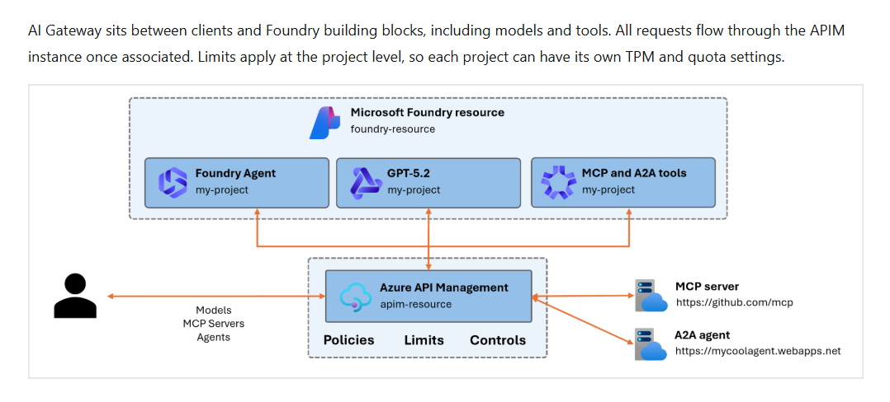

# APIM Design — Fine-Grained Routes & Policies

Design for the **API Management Standard v2** instance that fronts every upstream the app calls.
Every logical upstream is its own **API**, and every upstream call is its own **named operation**
so metrics, logs, rate limits, and traces are per-operation ("fine-grained visibility").

> **Sprint 1 (current) — open network.** The stamp uses a **bring-your-own APIM** reached on its
> **public gateway** (`<your-apim-service-name>.azure-api.net`); only the iManage **Work** + **MCP** routes
> are registered on it today (see [`traffic-routing.md`](./traffic-routing.md)). The private
> posture described below (public access disabled, inbound Private Endpoint, outbound VNet
> integration + NAT Gateway) and the Models/Agents/OAuth routes are the **deferred Sprint 2**
> target design.

See the companion [`policies/`](./policies) outlines and [`../architecture/README.md`](../architecture/README.md).
For how the web app's live traffic actually reaches these routes (and how to switch mock→live),
see [`traffic-routing.md`](./traffic-routing.md).

## 1. API catalog

| APIM API | API path | Backend | Auth injected by APIM |
|---|---|---|---|
| **Models** | `/models` | Foundry account (private endpoint) | Managed-identity token (keys disabled) |
| **Agents** | `/agents` | Foundry Agent Service (private) | Managed-identity token |
| **iManage Work** | `/imanage/work` | **backend entity `imanage-work-backend`** → mock upstream (PE) or `{tenant}.cloudimanage.com/work/api/v2` (NAT) | Subscription key; caller bearer forwarded |
| **iManage MCP** | `/imanage/mcp` | **backend entity `imanage-mcp-backend`** → mock upstream (PE) or `{tenant}.cloudimanage.com/mcp` (NAT) | Subscription key; caller bearer forwarded |
| **iManage OAuth** | `/imanage/oauth` | iManage token host (NAT egress) | Client secret from Key Vault named value |

> **Swappable backend.** The Work and MCP APIs point at APIM **backend entities** rather than a
> literal URL. The `imanageBackendMode` parameter (`mock` \| `live`) sets whether those entities
> resolve to the private **Mock iManage Upstream** (no egress) or the real iManage tenant (via
> NAT). Routes, operations, and policies are identical in both modes — swapping mock→live is a
> one-parameter backend change with no API/policy edits. OAuth is `live`-only (mock issues a
> local stub token when `mock`). The mock upstream publishes an **OpenAPI/Swagger** document
> (Swagger UI at `/docs`) that can seed the APIM Work API import and lets the emulated surface be
> explored/tested directly before a live tenant exists.

## 2. Operations (fine-grained)

### Models — `/models`
Backend: Foundry account (private). The agent uses **chat completions**; `responses`/`embeddings`
are forward-looking (safe to expose, mark optional).
| Operation | Method | Path | Notes |
|---|---|---|---|
| `chat-completions` | POST | `/{deployment}/chat/completions` | **primary** (agent + mock-real model); emits token-usage metric |
| `responses` | POST | `/{deployment}/responses` | optional/forward-looking |
| `embeddings` | POST | `/{deployment}/embeddings` | optional/forward-looking |

### Agents — `/agents`
The AI agent runs as a **Foundry hosted agent** (not in the web app); these operations drive it.
| Operation | Method | Path | Notes |
|---|---|---|---|
| `create-thread` | POST | `/threads` | |
| `run-turn` | POST | `/threads/{threadId}/runs` | carries forwarded user token as structured input |
| `get-run` | GET | `/threads/{threadId}/runs/{runId}` | |
| `list-messages` | GET | `/threads/{threadId}/messages` | |

### iManage Work — `/imanage/work`
Base: `{tenant}.cloudimanage.com/work/api/v2`. **All production calls are `GET`** (the classic
surface honors the UI filters on `GET /documents`). `POST /documents/search` is **not** used in
production — it is a diagnostics-only surface and is intentionally excluded.

| Operation | Method | Path | Used by |
|---|---|---|---|
| `documents-list` | GET | `/customers/{cid}/documents` | Documents & Emails search (params carry grammar) |
| `documents-list-scoped` | GET | `/customers/{cid}/libraries/{lib}/documents` | single-library search |
| `documents-recent` | GET | `/customers/{cid}/documents/recent` | Recent documents feed |
| `documents-checkedout` | GET | `/customers/{cid}/documents/checkedout` | Checked-out feed |
| `documents-favorites` | GET | `/customers/{cid}/documents/favorites` | Favorites feed |
| `document-get` | GET | `/customers/{cid}/libraries/{lib}/documents/{num}` | document detail |
| `document-versions` | GET | `/customers/{cid}/libraries/{lib}/documents/{num}/versions` | versions |
| `document-text` | GET | `/customers/{cid}/libraries/{lib}/documents/{num}/text` | extracted text (primary) |
| `document-download` | GET | `/customers/{cid}/libraries/{lib}/documents/{num}/download` | text fallback when `/text` empty |
| `workspaces-search` | GET | `/customers/{cid}/workspaces` | Matters search |
| `workspaces-recent` | GET | `/customers/{cid}/recent-workspaces` | Recent Matters feed (distinct from search) |
| `workspace-documents` | GET | `/customers/{cid}/libraries/{lib}/workspaces/{num}/documents` | matter documents |
| `workspace-children` | GET | `/customers/{cid}/libraries/{lib}/workspaces/{wid}/children` | matter folder tree |
| `folders-search` | GET | `/customers/{cid}/folders` | Folders search |
| `folder-children` | GET | `/customers/{cid}/libraries/{lib}/folders/{fid}/children` | folder open |
| `clients-search` | GET | `/customers/{cid}/libraries/{lib}/customs/custom1/search` | Clients lookup (`custom1`) |
| `users-search` | GET | `/customers/{cid}/libraries/{lib}/users` | resolve author/typist → user ids |
| `user-profile` | GET | `/api` | current-user name/profile (root `/api`, JWT fallback first) |
| `libraries` | GET | `/customers/{cid}/libraries` | list libraries |

### iManage MCP — `/imanage/mcp`
A **single JSON-RPC endpoint** (`MCP_SEARCH_URL`, e.g. `{tenant}.cloudimanage.com/mcp/search`).
APIM must preserve the **`Mcp-Session-Id`** response header across the call sequence and follow
the initial **3xx redirect** to the `location` session URL. All calls are `POST` to the same URL
with a JSON-RPC body; operations below are logical (distinguished by `method`/tool name).

| Operation | JSON-RPC | Notes |
|---|---|---|
| `initialize` | `initialize` | establishes session; returns `Mcp-Session-Id` (+ possible redirect) |
| `list-tools` | `tools/list` | called before `search` |
| `search` | `tools/call` → `search` | args: `question`, `library` |
| `fetch` | `tools/call` → `fetch` | args: `library`, `documentNumber`, `textChunkIndex`, `includeMetadata` |
| `call-tool` | `tools/call` → generic | forward-compatible for future tools |

### iManage OAuth — `/imanage/oauth`
Server-to-server only (interactive authorize stays browser→iManage). Two upstreams: **Work** and
**MCP** have separate token hosts/clients.

| Operation | Method | Path | Notes |
|---|---|---|---|
| `work-token` | POST | `/auth/oauth2/token` (Work host) | authorization_code exchange (PKCE) |
| `work-refresh` | POST | `/auth/oauth2/token` (grant=refresh_token) | silent refresh |
| `mcp-token` | POST | `/mcp/oauth2/token` | authorization_code exchange (PKCE + `resource`) |
| `mcp-resource-metadata` | GET | `/.well-known/oauth-protected-resource/mcp/search` | discover `resource` + `scope` before authorize |

## 3. Policy design

### 3.1 Global (all APIs)
- `set-header` correlation id (`x-correlation-id`) — generate if absent, propagate downstream.
- `cors` — same-origin only (the private App Service host).
- Emit custom metrics: dimensions `api`, `operation`, `status`, and `library` where present.
- `set-backend-service` to the private backend (base URL per API).
- Strip hop-by-hop headers; **scrub** `Authorization` / `X-Auth-Token` from any diagnostic log.

### 3.2 Models & Agents
> **AI Gateway topology** — the gateway sits between clients and the project's Foundry building
> blocks (agent, model, MCP/A2A tools); once the project is associated, **all** its requests flow
> through APIM, where **Policies / Limits / Controls** apply **per project**.
>
> 
>
> Source: [Configure AI Gateway in your Foundry resources](https://learn.microsoft.com/en-us/azure/foundry/configuration/enable-ai-api-management-gateway-portal) (Microsoft Learn).

**Baseline = Foundry ↔ APIM AI Gateway managed policies.** The Models (and Foundry agent
inference) API is created via Foundry's **AI Gateway** integration / APIM's *Import Azure AI
Foundry*, which provisions the API, backend(s), managed-identity auth, and recommended GenAI
policies. We adopt these managed policies rather than hand-rolling model governance:
- `azure-openai-token-limit` / `llm-token-limit` — token-based rate + quota (preferred over a raw
  byte-size guard).
- `azure-openai-emit-token-metric` / `llm-emit-token-metric` — prompt/completion/total token
  metrics for cost + capacity.
- **Backend pool load-balancing + circuit breaker** across model deployments/regions.
- Optional **AI content-safety** pre-check hook.
- **Semantic caching is intentionally NOT used** for this solution (`llm-semantic-cache-*` omitted).

**Our additions (deltas on top of the generated policy):**
- **Hosted-agent inference governed via Foundry AI Gateway (project scope).** Enabling **AI
  Gateway** on the Foundry *resource* (**Manage → AI Gateway**, *Use existing APIM* = this private
  Standard v2 instance) and adding the *project* routes **all** of that project's requests —
  **including the hosted agent's model inference** — through APIM automatically, so
  `llm-token-limit`/`llm-emit-token-metric` **enforce + measure** agent token usage. Limits/quota
  apply **per project**. This is the first-class Foundry feature, distinct from APIM-side *Import
  Azure AI Foundry* (an inbound front door only). APIM must be privately reachable because Foundry
  public access is disabled. Governing the **MCP tool** through the gateway is a **preview** path;
  our `/imanage/mcp` route gives per-call tool visibility regardless. Validated at **Gate G1**.
- `x-correlation-id` propagation + our custom metric dimensions (`api`, `operation`, `deployment`).
- Agents `run-turn`: accept the caller's forwarded iManage token as a **structured input** in the
  body; never log the body; forward unchanged to Agent Service.
- Managed-identity token to Foundry (keys disabled) — wired by the AI Gateway import; we only
  confirm the UAMI + `Cognitive Services OpenAI User` role.

### 3.3 iManage Work & MCP
- `set-header Ocp-Apim-Subscription-Key` from named value.
- Forward the caller's iManage bearer (`X-Auth-Token` for Work, `Authorization` for MCP)
  unchanged — APIM does not mint iManage tokens.
- Per-operation `log-to-eventhub`/App Insights: method, path, status, latency, `library`.
- `retry` on 429/5xx with capped exponential backoff; `timeout` guard.
- **(Sprint 2 target)** Egress pinned to **NAT Gateway** outbound IP (allow-listable at iManage if required). Sprint 1 egresses to iManage over the public internet from the APIM gateway.

### 3.4 iManage OAuth
- `token` / `refresh`: inject `client_secret` from **Key Vault-backed named value**; never
  return the secret; log issuance **events only** (subject, client_id, status) — **no token
  material**.
- Validate `redirect_uri` against an allow-list parameter.

### 3.5 Security posture (all)
- **(Sprint 2 target)** Public network access **Disabled**; reachable only via private endpoint. Sprint 1 uses the BYO APIM public gateway.
- Optional `validate-jwt` (Entra) and/or client-IP allow-list for defense in depth.
- TLS 1.2+ end to end; all backends private or via NAT.

## 4. Named values / secrets (Key Vault-backed)
| Named value | Source | Used by |
|---|---|---|
| `imanage-subscription-key` | Key Vault | Work, MCP |
| `work-client-secret` | Key Vault | OAuth `token`/`refresh` |
| `mcp-client-secret` | Key Vault | OAuth `token`/`refresh` |
| `redirect-uri-allowlist` | config param | OAuth |
| `imanage-backend-mode` | config param (`mock`\|`live`) | selects Work/MCP backend entity |
| `imanage-work-base-url` | config param | `imanage-work-backend` target (mock PE or tenant) |
| `imanage-mcp-base-url` | config param | `imanage-mcp-backend` target (mock PE or tenant) |
| `imanage-work-auth-base-url` | config param | OAuth `work-token`/`work-refresh` host |
| `imanage-mcp-auth-base-url` | config param | OAuth `mcp-token`/`mcp-resource-metadata` host |
| `foundry-backend-base-url` | config param | Models/Agents backend base URL |
| `foundry-uami-client-id` | config param | managed-identity auth to Foundry |
| `spa-origin` | config param | CORS allow-list (private SPA host) |
| `models-rate-calls` / `models-quota-calls` / `models-max-request-bytes` | config param | Models/Agents rate, quota, size guards |

> Policy XML outlines that consume these named values live in [`policies/`](./policies/README.md):
> `global.xml`, `models-agents.xml`, `imanage-work-mcp.xml`, `imanage-oauth.xml`. Each iManage
> operation is a **named APIM operation**, and `imanage-work-mcp.xml` emits one structured log
> line **per upstream call** (api, operation, method, path, library, status, latency, backendMode)
> so operators can see exactly which iManage API calls are made.

## 5. Observability outputs
- Per-operation request logs + metrics to **Application Insights / Log Analytics**.
- Dashboards: calls per iManage operation, per library, latency p50/p95, error codes, model
  token usage, agent-turn traces by `x-correlation-id`.
- Alerts: error-rate, latency, and token-usage thresholds.

## 6. API coverage & excluded surfaces

The iManage API surface the product exposes, in three buckets:

- **Production (covered above):** 19 Work operations, 5 MCP logical operations, 4 OAuth
  operations, and chat-completions. Every upstream the app invokes has an APIM operation.
- **Diagnostics-only (intentionally excluded):** `POST /customers/{cid}/documents/search`,
  `POST .../emails/search`, `.../workspaces/search`, `/users/current`, `/recent/documents`, and
  an exploratory probe matrix. These are not part of the product surface. If an operator wants
  them, add a separate `imanage-work-diag` API gated to admins.
- **Net-new / forward-looking:** the `/agents` route (Foundry hosted agent) and the
  `responses`/`embeddings` model operations.

**Two alternate iManage surfaces intentionally not exposed via APIM:**
- **Work "web" surface** (`/work/web/api/v2`): requires `X-XSRF-TOKEN` + session cookie, so it
  can't be called server-to-server. The product uses the **classic** `/work/api/v2` surface
  exclusively.
- **Direct Foundry project path** (`AIProjectClient` against the Foundry project endpoint, Entra
  ID): a local-dev connection style that bypasses APIM. In production, model and agent calls
  always go **through APIM** (`/models`, `/agents`).

**Call-grammar rules (enforced by the App Service proxy, not APIM):**
owner-vs-author, Documents Title `*term*` vs Matters Title bare `name`, `exclude_emails` vs
`email_only`+`group_by_conversation=false`, single comma `libraries` scope, `document_number`
for Number, `NOT term` negation, folder `type=regular,search` only all-libraries, full folder id
(`LIB!num`) on open. APIM forwards params unchanged; it does not rewrite grammar.
